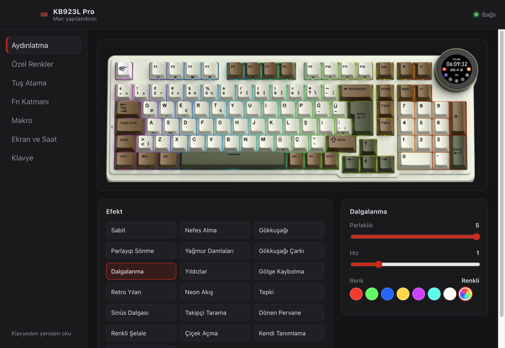

# KB923L Pro — Mac yapılandırıcı

**Havit KB923L Pro** klavyesi (yuvarlak ekranlı, RGB) için resmî olmayan macOS uygulaması. Üretici yalnız Windows
yazılımı veriyor; bu uygulama onun işlevlerini Mac'e taşıyor ve birkaç yenisini ekliyor.

> Havit ile bir bağı yoktur; protokol Windows yazılımının incelenmesiyle çıkarılmıştır. Kullanım sorumluluğu size aittir.



## Neler var

| | |
|---|---|
| **Aydınlatma** | 19 efekt, parlaklık, hız, 7 renk + renkli; uyku süresi |
| **Özel renkler** | Tuş başına RGB, klavye görseli üzerinde boyama |
| **Tuş atama** | Herhangi bir tuşa başka tuş, değiştirici, medya / uygulama tuşu ya da fare tuşu; Alt ↔ Win (Mac düzeni) |
| **Fn katmanı** | Bir katman tuşu seçin (ör. Caps Lock): basılıyken H J K L → oklar gibi; kısa basışta Esc. Tuş (+⌘⌥⌃⇧), medya, fare, makro |
| **Makro** | Klavyeden kayıt ya da elle; bekleme, metin (Türkçe karakterli), fare tıkı; bir kez / basılı tuttukça / aç-kapa |
| **Fare tuşları** | Sol / sağ / orta tık, geri / ileri, tekerlek; çift tık ve sürükleme çalışır |
| **Monitör sesi** | Ses HDMI / DisplayPort monitöre giderken macOS'un ayarlayamadığı seviyeyi yazılımla ayarlar; klavyenin ses düğmesi ve Mac'in ses tuşları çalışır |
| **Ekran** | Mac'in saati ve ses seviyesi; ekrana **GIF / resim yükleme** (240×240, en çok 35 kare), yuvarlak önizleme |
| **Hazır ekran görüntüleri** | Fabrika görüntüsü, Apple logosu, dalgalanan Türk bayrağı, Atatürk, radar |

Tuş atama, Fn katmanı, makro ve fare işlevleri **Mac tarafında** çalışır (klavyenin hafızasına yazılmaz): uygulama açık
olmalıdır (pencereyi kapatınca menü çubuğunda çalışmaya devam eder; "Mac açılınca başlat" seçeneği var).
Aydınlatma, özel renkler ve ekran görüntüsü klavyenin kendisine kaydedilir.

## Kurulum

Gereken: Apple Silicon (M1–M4) Mac, macOS 14.2 ya da üstü, USB kabloyla bağlı KB923L Pro.

1. [Releases](../../releases/latest) sayfasından `KB923L-Pro-mac-arm64.zip`'i indirin, açın ve `KB923L Pro.app`'i
   **Uygulamalar** klasörüne sürükleyin.
2. Uygulama Apple'a kayıtlı bir geliştirici imzası taşımadığı için macOS ilk açılışta engeller. Terminal'de bir kez:

   ```sh
   xattr -dr com.apple.quarantine "/Applications/KB923L Pro.app"
   ```

   (ya da Sistem Ayarları → Gizlilik ve Güvenlik → "Yine de Aç").
3. Uygulamayı açın ve iki izni verin (Sistem Ayarları → Gizlilik ve Güvenlik):
   - **Giriş İzleme** — klavyeyle konuşmak için (uygulama izin penceresini kendisi açar). İzni verdikten sonra
     uygulamadaki **"Uygulamayı yeniden başlat"**a basın.
   - **Erişilebilirlik** — makro, Fn katmanı, fare tuşları ve ses tuşları için (ilgili sekmede "İzin iste").
   - **Sistem Sesi Kaydı** — yalnız monitör sesini yazılımla ayarlamak için (ses HDMI / DisplayPort'a giderken sorulur).

### Sorun çıkarsa

- Klavye görünmüyor: Giriş İzleme'de "KB923L Pro" açık mı? Listede eski bir kayıt varsa "−" ile silip yeniden ekleyin.
- Tuş atamalarını elle kaldırmak:
  `hidutil property --matching '{"VendorID":9610,"ProductID":535}' --set '{"UserKeyMapping":[]}'`
- Klavyeyi fabrika ayarına döndürmek: uygulamada **Klavye → Fabrika ayarlarına dön**.
- Kayıt dosyası: `~/Library/Logs/KB923L Pro/main.log`

## Kaynaktan derleme

```sh
npm install
npm start           # derle ve aç (geliştirme)
npm run dist        # release/mac-arm64/KB923L Pro.app
```

Xcode komut satırı araçları gerekir (makro yardımcısı `helper/kbmacro.swift`, `swiftc` ile derlenir).
`npm run dist` paketi `tools/sign.sh` ile imzalar: "KB923L Yerel Imza" sertifikası varsa onunla (izinler derlemeler
arasında korunur; `tools/make-cert.sh` oluşturur), yoksa ad-hoc. VS Code terminalinde `ELECTRON_RUN_AS_NODE` tanımlıysa
`env -u ELECTRON_RUN_AS_NODE npm start` kullanın.

Yapı: `electron/` (ana süreç: HID protokolü, hidutil, makro motoru, ekran yükleme), `helper/` (Swift: tuş/fare olayı
gönderme, Fn katmanı olay dinleyicisi), `src/` (React arayüz), `tools/` (deneme betikleri).
Protokol ve ölçümler: [docs/PROTOKOL.md](docs/PROTOKOL.md).

## Lisans ve haklar

Kod [MIT](LICENSE) lisanslıdır. Şunlar MIT kapsamında değildir:
- `src/assets/keyimg.png` (klavye görseli) ve `src/assets/screen-default.gif` (fabrika ekran görüntüsü) Havit'in
  Windows yazılımından alınmıştır; hakları Havit'e aittir.
- `src/assets/ataturk-1936.jpg`: Wikimedia Commons, "Mustafa Kemal Atatürk siyah beyaz.jpg", CC0.
- Apple logosu macOS'un sistem yazı tipindeki  karakteriyle çalışma anında çizilir; Apple, Apple Inc.'in ticari markasıdır.
